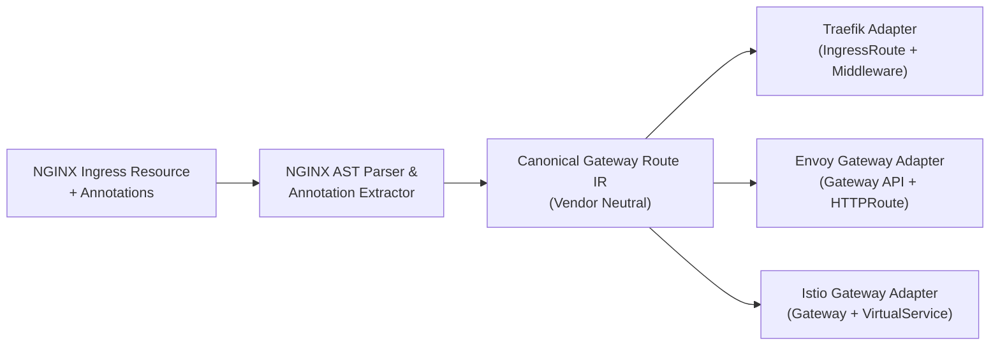
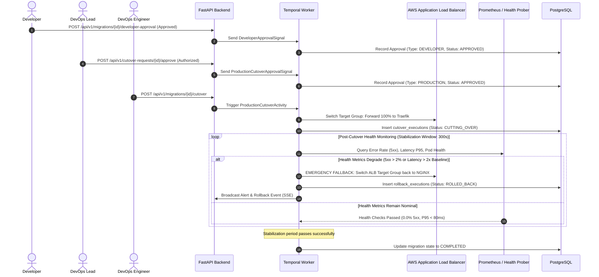

# Technical Design Document (TDD) — Part 1: System Design

# Kubernetes Migration Manager (KMM) — Architecture & Topology

**Version:** 2.0  
**Status:** Implementation Blueprint  
**Primary Target Platform:** AWS EKS (with architectural abstraction for Azure AKS and Google Cloud GKE)  
**Standard Specification:** Kubernetes Gateway API v1 + Controller-Specific CRD Adapters  

---

## 1. System Overview & Core Architectural Principles

Kubernetes Migration Manager (KMM) is an enterprise-grade, event-driven orchestration system built to automate, validate, and safely execute production ingress migrations from **NGINX Ingress Controller** to **Traefik**, **Envoy Gateway**, or **Istio Gateway**.

### Core Architecture Tenets
1. **Live Infrastructure Reality**: All cluster discovery, resource inspections, health evaluations, and cutover verifications run against live Kubernetes and Cloud Provider APIs. Zero mock data.
2. **Durable Asynchronous Workflows**: Long-running infrastructure migrations run inside **Temporal.io** stateful workflows. If an application worker crashes, restarts, or deploys, state machines resume from persisted event history with zero data loss.
3. **Canonical Intermediate Representation (IR)**: Ingress rules, TLS terminations, path transforms, rate-limiting, and header manipulations are decoupled from NGINX YAML into a strongly-typed `GatewayRouteIR`. Controller adapters project this IR into Gateway API (`Gateway`, `HTTPRoute`, `ReferenceGrant`) and controller-specific CRDs (e.g. Traefik `IngressRoute`, `Middleware`).
4. **Append-Only Immutable Auditing**: Every user action, automated health probe, state transition, and configuration diff is written sequentially to an immutable, append-only event stream and PostgreSQL audit table.
5. **Zero-Planned-Downtime Traffic Handover**: Production DNS or Cloud Load Balancer (AWS ALB / NLB Target Groups) handles the physical switchover after runtime pre-validation and dual approvals.

---

## 2. High-Level Component Architecture

```mermaid
flowchart TB
    subgraph Client_Layer [Client & Presentation Layer]
        UI["React 18 + TypeScript Web Portal<br/>(Material UI 5, Vite)"]
        WS_CLIENT["WebSocket / SSE Client<br/>(Real-Time Activity Stream)"]
    end

    subgraph API_Layer [API & Edge Gateway]
        FASTAPI["FastAPI 0.110+ Service<br/>(Async REST API, Auth, OpenAPI)"]
        OIDC["Enterprise OIDC / Keycloak / Dex<br/>(JWT Bearer Token RBAC)"]
        EVENT_BUS["Event Streaming Hub<br/>(FastAPI SSE & WebSockets)"]
    end

    subgraph Orchestration_Layer [Orchestration & Workflow Engine]
        TEMPORAL_SRV[("Temporal Server Cluster<br/>(Temporal Orchestrator)")]
        REDIS_CACHE[("Redis 7.2 Cluster<br/>(Cache, Rate Limiting, Idempotency)")]
        KMM_WORKER["KMM Temporal Worker Pool<br/>(Python Temporal SDK)"]
    end

    subgraph Core_Engines [Domain Engine Subsystems]
        DISC["Live Discovery Engine<br/>(K8s Dynamic Client / API)"]
        ASSESS["Compatibility Assessment Engine<br/>(NGINX AST & Annotation Parser)"]
        CONV["Canonical IR & Conversion Engine<br/>(Gateway API & CRD Generator)"]
        BACKUP["Backup & Verification Engine<br/>(Manifest & Secret Envelope Encryptor)"]
        DEPLOY["Helm Deployment Service<br/>(Helm 3 SDK & CRD Manager)"]
        DNS_TLS["Runtime URL & DNS Engine<br/>(Route53 / ExternalDNS / CertManager)"]
        TEST_PROBE["Testing & Health Engine<br/>(Synthetic HTTP/gRPC Probers)"]
        CUTOVER["Cutover & Traffic Switching Engine<br/>(AWS ALB / NLB Target Group Switcher)"]
        ROLLBACK["Automated Rollback Engine<br/>(Circuit Breaker & Fallback Driver)"]
    end

    subgraph Data_Layer [Data & Storage Layer]
        PG[("PostgreSQL 16 Cluster<br/>(Partitioned Audit Logs, 34 Entities)")]
        S3_STORAGE[("Encrypted Object Storage<br/>(AWS S3 / KMS AES-256)")]
    end

    subgraph Target_Infrastructure [Managed Target Infrastructure (AWS EKS)]
        K8S_API["Kubernetes API Server (EKS)"]
        AWS_ALB["AWS Application Load Balancer"]
        NGINX_ING["NGINX Ingress Controller<br/>(Active Production)"]
        TRAEFIK_ING["Traefik Gateway Controller<br/>(Deployed in Parallel)"]
        APP_PODS["Application Services & Pods"]
    end

    UI --> FASTAPI
    WS_CLIENT <--> EVENT_BUS
    FASTAPI --> OIDC
    FASTAPI --> REDIS_CACHE
    FASTAPI --> PG
    FASTAPI --> TEMPORAL_SRV

    TEMPORAL_SRV <--> KMM_WORKER
    KMM_WORKER --> DISC
    KMM_WORKER --> ASSESS
    KMM_WORKER --> CONV
    KMM_WORKER --> BACKUP
    KMM_WORKER --> DEPLOY
    KMM_WORKER --> DNS_TLS
    KMM_WORKER --> TEST_PROBE
    KMM_WORKER --> CUTOVER
    KMM_WORKER --> ROLLBACK

    KMM_WORKER --> PG
    KMM_WORKER --> EVENT_BUS
    BACKUP --> S3_STORAGE

    DISC --> K8S_API
    DEPLOY --> K8S_API
    CUTOVER --> AWS_ALB
    ROLLBACK --> AWS_ALB
    TEST_PROBE --> TRAEFIK_ING
    TEST_PROBE --> NGINX_ING
    AWS_ALB --> NGINX_ING
    AWS_ALB -.-> TRAEFIK_ING
    NGINX_ING --> APP_PODS
    TRAEFIK_ING --> APP_PODS
```

---

## 3. Subsystem Breakdown & Technical Specifications

### 3.1 API & Real-Time Event Hub (FastAPI + Redis)
- **Framework**: Python 3.12 + FastAPI.
- **Async Execution**: `asyncio` with `uvloop`.
- **Authentication**: JWT verification using OpenID Connect (OIDC) Discovery (`/.well-known/openid-configuration`) with public keys cached in Redis.
- **RBAC Enforcement**: Declarative dependency injection via `SecurityScopes`:
  - `admin`, `devops`, `developer`, `approver` (DevOps Lead), `auditor`.
- **Idempotency Enforcement**: Middleware checks `X-Idempotency-Key` against `idempotency_records` in PostgreSQL/Redis before executing any mutating state transition.
- **Live Event Streaming**: Server-Sent Events (SSE) `/api/v1/migrations/{id}/events` and WebSockets `/ws/timeline` backed by Redis Pub/Sub, broadcasting state changes, Kubernetes pod logs, and diagnostic telemetry to connected UI clients within < 500ms.

### 3.2 Durable Workflow Engine (Temporal.io)
Migrations are coordinated using Temporal workflows:
- **MigrationWorkflow**: Main orchestrator containing 15 sequential and conditional stages.
- **Activity Execution Properties**:
  - `ScheduleToCloseTimeout`: 1 hour for long-running manual approvals.
  - `StartToCloseTimeout`: 5–15 minutes for Kubernetes/Helm operations.
  - `RetryPolicy`: Exponential backoff with `InitialInterval = 2s`, `BackoffCoefficient = 2.0`, `MaximumInterval = 30s`, `MaximumAttempts = 5`.
  - Non-retryable errors explicitly defined for authorization failures, invalid annotations, and failed checksums.
- **Signals**:
  - `DeveloperApprovalSignal(approved: bool, reason: str, test_evidence_id: str)`
  - `ProductionCutoverApprovalSignal(approved: bool, lead_id: str, change_window_id: str)`
  - `TriggerEmergencyRollbackSignal(reason: str, operator_id: str)`
- **Queries**:
  - `GetMigrationStatus()`: Returns live execution state, completed stages, and blocking conditions.

### 3.3 Kubernetes Live Discovery Engine
- **Client**: `kubernetes_asyncio` and dynamic Python Kubernetes API clients.
- **Cluster Discovery Sequence**:
  1. Test API Connectivity: `GET /version` and `GET /api/v1/namespaces`.
  2. RBAC Self-Subject-Rules Check: Validate `create`, `get`, `list`, `watch`, `update`, `patch` on `networking.k8s.io`, `gateway.networking.k8s.io`, and `traefik.io` CRDs.
  3. Ingress & Controller Inventory:
     - Fetch all `Ingress` (v1) and `IngressClass` objects.
     - Detect NGINX controller deployments (`k8s-app=nginx-ingress-controller` or `ingress-nginx`).
     - Query CRD registrations for `gatewayclasses.gateway.networking.k8s.io`, `ingressroutes.traefik.io`, etc.
  4. Store immutable `discovery_snapshots` and child `discovered_resources` in PostgreSQL as JSONB.

### 3.4 Canonical Intermediate Representation (IR) & Converter
To ensure seamless multi-target support without rewriting parser logic for each controller:



#### Canonical IR Data Model (`GatewayRouteIR`)
- `hosts`: List of FQDN strings.
- `paths`: Path matchers (Exact, Prefix, Regex).
- `backends`: Service name, namespace, port, weight.
- `tls_configs`: Secret references, minimum TLS version, SNI hostnames.
- `policies`:
  - `RewritePolicy`: Prefix strip, path replace, regex rewrite.
  - `RedirectPolicy`: HTTP-to-HTTPS redirect, scheme/port rewrite.
  - `RateLimitPolicy`: Requests per second/minute, burst size.
  - `AuthPolicy`: BasicAuth secret, ForwardAuth URL and headers.
  - `SecurityHeadersPolicy`: HSTS, CSP, FrameOptions, CORS rules.
  - `TimeoutPolicy`: Connect timeout, read timeout, keepalive timeout.
  - `BodyLimitPolicy`: Max payload size in MB.
  - `IPFilterPolicy`: CIDR allowlist/denylist.

### 3.5 Target Gateway Controller Adapter Interface
Every adapter conforms to a standardized Python abstract interface:

```python
from abc import ABC, abstractmethod
from typing import Dict, Any, List
from models.ir import GatewayRouteIR
from models.results import AdapterValidationResult, DeploymentStatus

class GatewayControllerAdapter(ABC):
    @abstractmethod
    async def discover_capabilities(self, cluster_client: Any) -> Dict[str, Any]:
        """Detect controller version, CRD support, and Gateway API conformance."""
        pass

    @abstractmethod
    async def convert_to_manifests(self, route_ir: GatewayRouteIR, namespace: str) -> List[Dict[str, Any]]:
        """Transform vendor-neutral IR into target controller manifests."""
        pass

    @abstractmethod
    async def validate_manifests(self, manifests: List[Dict[str, Any]], cluster_client: Any) -> AdapterValidationResult:
        """Run server-side dry-run and structural CRD validation."""
        pass

    @abstractmethod
    async def deploy_controller(self, cluster_client: Any, config: Dict[str, Any]) -> DeploymentStatus:
        """Deploy or verify parallel controller installation via Helm."""
        pass

    @abstractmethod
    async def verify_routing_ready(self, route_name: str, namespace: str, cluster_client: Any) -> bool:
        """Verify Gateway/Route programming status and controller readiness."""
        pass
```

#### Traefik Adapter Implementation Details:
- Translates `GatewayRouteIR` to `traefik.io/v1alpha1` `IngressRoute` and `Middleware` resources.
- Rate limiting $\rightarrow$ `Middleware` of type `RateLimit`.
- Path rewriting $\rightarrow$ `Middleware` of type `StripPrefix` or `ReplacePathRegex`.
- Security headers $\rightarrow$ `Middleware` of type `Headers`.
- IP AllowList $\rightarrow$ `Middleware` of type `IPAllowList`.
- Deploys Traefik using official Helm chart (`traefik/traefik`) into isolated `kmm-traefik-system` namespace.
- Creates unique `IngressClass` named `traefik-migration` to prevent collision with default NGINX ingress class.

---

## 4. Deployment Topology (AWS EKS Target Architecture)

The reference architecture runs on **AWS EKS**, managing target workloads while maintaining isolation.

```mermaid
flowchart TB
    subgraph AWS_VPC [AWS Cloud VPC (10.100.0.0/16)]
        subgraph Public_Subnets [Public Subnets - Multi-AZ]
            ALB["AWS Application Load Balancer (Internet-Facing)<br/>DNS: app.company.com"]
            RUNTIME_ALB["Traefik Pre-Production ALB<br/>DNS: runtime-app.company.com"]
        end

        subgraph Private_Subnets [Private Worker Subnets - Multi-AZ]
            subgraph EKS_Cluster [AWS EKS Cluster v1.28+]
                subgraph NGINX_NS [Namespace: ingress-nginx]
                    NGINX_PODS["NGINX Ingress Controller Pods<br/>Service Type: NodePort / ClusterIP"]
                end

                subgraph TRAEFIK_NS [Namespace: kmm-traefik-system]
                    TRAEFIK_PODS["Traefik Controller Pods<br/>(IngressClass: traefik-migration)<br/>Service Type: NodePort / TargetGroupBinding"]
                end

                subgraph APP_NS [Namespace: production-apps]
                    APP_SVC["Application Service<br/>(ClusterIP: 8080)"]
                    APP_PODS["App Pod Replicas"]
                end

                subgraph KMM_MGMT_NS [Namespace: kmm-platform-system]
                    KMM_API["KMM FastAPI Backend Pods"]
                    KMM_WORKERS["KMM Temporal Worker Pods"]
                    KMM_TEMPORAL["Temporal Orchestration Cluster"]
                end
            end

            subgraph AWS_Managed [AWS Managed Services]
                RDS_PG[("Amazon RDS PostgreSQL 16<br/>(Multi-AZ)")]
                S3_BACKUP[("Amazon S3 Bucket<br/>(KMS Encrypted Backups)")]
                ROUTE53["Amazon Route 53<br/>Hosted Zone"]
                ACM["AWS Certificate Manager / cert-manager"]
            end
        end
    end

    INTERNET((Internet Users)) --> ALB
    DEVELOPERS((Developers)) --> RUNTIME_ALB

    ALB -- "TG-NGINX (Prod Weight 100%)" --> NGINX_PODS
    ALB -. "TG-Traefik (Cutover Switch)" .-> TRAEFIK_PODS
    RUNTIME_ALB --> TRAEFIK_PODS

    NGINX_PODS --> APP_SVC
    TRAEFIK_PODS --> APP_SVC
    APP_SVC --> APP_PODS

    KMM_WORKERS --> RDS_PG
    KMM_WORKERS --> S3_BACKUP
    KMM_WORKERS --> ROUTE53
    KMM_WORKERS --> ALB
```

### 4.1 Traffic Management & Zero-Downtime Switching Strategy
1. **AWS TargetGroupBinding Pattern**:
   - The primary production ALB possesses two Target Groups:
     - `TG-NGINX-Prod` (targets NGINX controller pods).
     - `TG-Traefik-Migration` (targets Traefik controller pods).
   - Before cutover: ALB Listener Rule forwards 100% traffic to `TG-NGINX-Prod`.
   - Traefik controller is simultaneously bound to `RUNTIME_ALB` for testing.
2. **Cutover Execution**:
   - Automated modification of ALB Listener rules via AWS API:
     - **Canary/Weighted option**: 90% NGINX / 10% Traefik $\rightarrow$ 50/50 $\rightarrow$ 100% Traefik.
     - **Direct Zero-Downtime switch**: Instantaneous target group switch with AWS ALB deregistration delay (connection draining) set to 300 seconds on `TG-NGINX-Prod`.
   - DNS remains static (`app.company.com` continuously points to the same ALB Alias).

### 4.2 Multi-Cloud Extensibility Layer
While AWS EKS uses ALB Target Groups, KMM abstracts the traffic cutover driver:
- **`AWSTrafficManager`**: Modifies AWS ALB Target Groups / Route 53 Weighted records.
- **`AzureTrafficManager`**: Modifies Azure Application Gateway Backend Pools / Azure Traffic Manager.
- **`GCPTrafficManager`**: Modifies GCP Cloud Armor / External HTTP(S) Load Balancer Backend Services.
- **`DNSCNAMETrafficManager`**: Fallback generic provider modifying Route53/Cloudflare CNAME with TTL pre-lowered to 30 seconds.

---

## 5. End-to-End Migration Sequence & Data Flows

### 5.1 Discovery & Assessment Flow

```mermaid
sequenceDiagram
    autonumber
    actor DevOps as DevOps Engineer
    participant UI as KMM Web Portal
    participant API as FastAPI Backend
    participant Worker as Temporal Worker
    participant K8s as Kubernetes API (EKS)
    participant DB as PostgreSQL

    DevOps->>UI: Select Cluster & Namespace
    UI->>API: POST /api/v1/clusters/{id}/discover
    API->>Worker: Trigger DiscoveryWorkflow
    Worker->>K8s: List Ingress, IngressClass, Deployments, Secrets
    K8s--Worker: Raw Kubernetes Manifests
    Worker->>DB: Store discovery_snapshots & discovered_resources
    Worker->>API: Discovery Completed Event (SSE)
    API-->>UI: Display Discovered Ingress Inventory

    DevOps->>UI: Run Compatibility Assessment
    UI->>API: POST /api/v1/migrations/{id}/assess
    API->>Worker: Trigger AssessmentActivity
    Worker->>Worker: Parse NGINX Annotations & Path Rules
    Worker->>Worker: Map against Gateway API & Traefik capability matrix
    Worker->>DB: Insert assessments & assessment_findings
    Worker->>API: Emit Assessment Completed Event
    API-->>UI: Display Compatibility Report (Supported, Warnings, Blockers)
```

### 5.2 Backup, Deployment & Runtime URL Verification Flow

```mermaid
sequenceDiagram
    autonumber
    actor DevOps as DevOps Engineer
    participant Worker as Temporal Worker
    participant S3 as Amazon S3 (Encrypted)
    participant K8s as Kubernetes API (EKS)
    participant Route53 as Amazon Route 53
    participant Probe as Synthetic Prober
    participant DB as PostgreSQL

    Note over Worker: Assessment Approved by DevOps
    Worker->>Worker: Build Backup Manifest Package
    Worker->>Worker: Encrypt Secret envelopes (AES-256-GCM / KMS)
    Worker->>Worker: Generate SHA-256 Checksums
    Worker->>S3: Upload backup package (tar.gz.enc)
    Worker->>DB: Insert backups record (Status: VERIFIED)

    Worker->>K8s: Deploy Traefik via Helm SDK (Namespace: kmm-traefik-system)
    Worker->>K8s: Apply Converted Traefik IngressRoute & Middleware
    Worker->>K8s: Poll Pod Readiness & Route Programming Status
    K8s--Worker: Traefik Pods Ready & IngressRoute Accepted

    Worker->>Route53: Create CNAME: runtime-app.company.com -> Traefik LB
    Worker->>Probe: Execute HTTP & TLS Handshake Probes on Runtime URL
    Probe-->>Worker: HTTP 200 OK, TLS Valid, Backend Reached
    Worker->>DB: Update runtime_endpoints (Status: HEALTHY)
```

### 5.3 Dual-Approval, Production Cutover & Rollback Flow



---

## 6. Resilience, Failure Modes & Disaster Recovery

| Failure Scenario | System Impact | Automated Remediation & Design Defense |
| :--- | :--- | :--- |
| **KMM Worker Crash / Pod Restart** | Temporal activity in progress interrupted | Temporal automatically detects worker heartbeat loss. Another worker in the pool picks up the workflow exactly from the last persisted state with no duplicate action. |
| **Kubernetes API Connectivity Loss** | Discovery or route application fails | Dynamic client implements exponential backoff retry. Workflow pauses in `BLOCKED` state without altering production traffic. |
| **Backup Integrity Checksum Mismatch** | Corrupt manifest or S3 upload failure | Workflow state transitions to `BLOCKED`. Migration engine strictly forbids target deployment or cutover until backup verification passes 100%. |
| **Traefik Deployment / CRD Failure** | Route resources not accepted | Helm rollout automatically aborted. Production NGINX is untouched. Detailed error logs captured in `activity_timeline`. |
| **Developer Application Test Rejection** | Defect identified in runtime routing | Workflow halts at `DEVELOPER_REJECTED`. Control returns to DevOps Engineer for configuration remediation; cutover cannot be scheduled. |
| **Post-Cutover 5xx Spike or Pod Crash** | Live production users encountering errors | Automatic circuit breaker: Monitored metric triggers automated rollback within 60s. ALB switches traffic back to verified NGINX target group. |
| **External DNS Propagation Delay** | Runtime URL not immediately resolving | Engine polls DNS resolution authoritative servers directly before launching Developer Validation window. |

---

*This concludes Part 1: System Design. Proceed to Part 2 for the complete Database Schema, DDL, and ER Model.*
