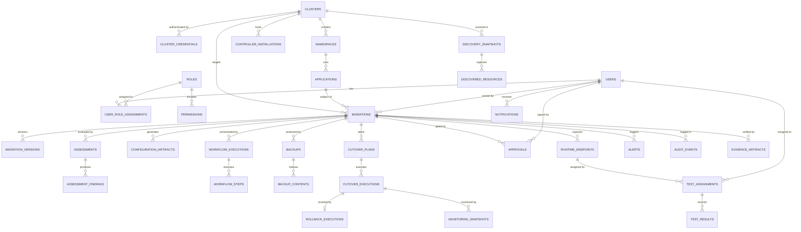

# Technical Design Document (TDD) — Part 2: Database Design

# Kubernetes Migration Manager (KMM) — Data Architecture & PostgreSQL Schema

**Version:** 2.0  
**Status:** Implementation Blueprint  
**Target Engine:** PostgreSQL 16+  
**ORM / Migration Tool:** SQLAlchemy 2.0 (Async) + Alembic  

---

## 1. Database Architecture & Design Principles

The KMM database stores cluster metadata, live discovery snapshots, configuration versions, workflow execution states, approval trails, and immutable audit logs.

### Key Architectural Decisions:
1. **Immutable Audit Trail (`audit_events`)**: System and user actions are append-only. A PostgreSQL database-level trigger prohibits `UPDATE` and `DELETE` operations on `audit_events`.
2. **Configuration Versioning (`migration_versions`)**: Every modification to source, intermediate, or target configuration creates an incremental, immutable version. Approvals are cryptographically tied to exact version numbers.
3. **Structured JSONB for Dynamic Manifests**: Kubernetes manifests, annotation maps, and compatibility findings are stored in indexed `JSONB` columns with GIN indexes, allowing high-performance querying without rigid schema churn.
4. **Time & Identity Standards**: All timestamps are `TIMESTAMPTZ` recorded strictly in UTC (`timezone('utc', now())`). Primary keys utilize `UUIDv4` (`gen_random_uuid()`) for decentralized, secure generation.
5. **Idempotency Records (`idempotency_records`)**: API mutation requests enforce client-provided `X-Idempotency-Key` headers stored in PostgreSQL with unique constraints and TTLs to prevent double-execution of cutovers or deployments.

---

## 2. Entity-Relationship (ER) Diagram



---

## 3. PostgreSQL 16 Production DDL (Schema)

```sql
-- ============================================================================
-- EXTENSIONS & CUSTOM ENUMS
-- ============================================================================
CREATE EXTENSION IF NOT EXISTS "uuid-ossp";
CREATE EXTENSION IF NOT EXISTS "pgcrypto";

CREATE TYPE user_role_enum AS ENUM (
    'PLATFORM_ADMIN',
    'DEVOPS_ENGINEER',
    'DEVELOPER',
    'DEVOPS_LEAD',
    'AUDITOR'
);

CREATE TYPE migration_state_enum AS ENUM (
    'DRAFT',
    'DISCOVERING',
    'ASSESSMENT',
    'BLOCKED',
    'READY_FOR_BACKUP',
    'BACKING_UP',
    'BACKUP_VERIFICATION',
    'READY_TO_DEPLOY',
    'DEPLOYING_TARGET',
    'CONFIGURING_ROUTES',
    'VALIDATING_TARGET',
    'RUNTIME_TESTING',
    'DEVELOPER_REJECTED',
    'DEVELOPER_APPROVED',
    'AWAITING_PRODUCTION_APPROVAL',
    'PRODUCTION_REJECTED',
    'APPROVED_FOR_CUTOVER',
    'CUTTING_OVER',
    'POST_CUTOVER_VALIDATION',
    'STABILIZING',
    'ROLLBACK_IN_PROGRESS',
    'ROLLED_BACK',
    'COMPLETED',
    'FAILED',
    'CANCELLED'
);

CREATE TYPE target_controller_enum AS ENUM (
    'TRAEFIK',
    'ENVOY_GATEWAY',
    'ISTIO_GATEWAY'
);

CREATE TYPE approval_type_enum AS ENUM (
    'DEVELOPER_TESTING',
    'PRODUCTION_CUTOVER',
    'NGINX_DECOMMISSION'
);

CREATE TYPE approval_status_enum AS ENUM (
    'PENDING',
    'APPROVED',
    'REJECTED'
);

CREATE TYPE finding_severity_enum AS ENUM (
    'INFO',
    'WARNING',
    'BLOCKER'
);

CREATE TYPE cutover_strategy_enum AS ENUM (
    'ALB_TARGET_GROUP_INSTANT',
    'ALB_WEIGHTED_CANARY',
    'DNS_CNAME_SWITCH'
);

CREATE TYPE backup_status_enum AS ENUM (
    'IN_PROGRESS',
    'VERIFIED',
    'FAILED',
    'CORRUPT'
);

-- ============================================================================
-- 1. AUTHENTICATION & ACCESS CONTROL ENTITIES
-- ============================================================================

CREATE TABLE IF NOT EXISTS users (
    id UUID PRIMARY KEY DEFAULT gen_random_uuid(),
    email VARCHAR(255) UNIQUE NOT NULL,
    full_name VARCHAR(255) NOT NULL,
    external_idp_id VARCHAR(255) UNIQUE,
    is_active BOOLEAN NOT NULL DEFAULT TRUE,
    created_at TIMESTAMPTZ NOT NULL DEFAULT timezone('utc', now()),
    updated_at TIMESTAMPTZ NOT NULL DEFAULT timezone('utc', now())
);

CREATE TABLE IF NOT EXISTS roles (
    id UUID PRIMARY KEY DEFAULT gen_random_uuid(),
    name user_role_enum UNIQUE NOT NULL,
    description TEXT
);

CREATE TABLE IF NOT EXISTS permissions (
    id UUID PRIMARY KEY DEFAULT gen_random_uuid(),
    role_id UUID NOT NULL REFERENCES roles(id) ON DELETE CASCADE,
    resource VARCHAR(100) NOT NULL,
    action VARCHAR(50) NOT NULL,
    CONSTRAINT uq_role_perm UNIQUE (role_id, resource, action)
);

CREATE TABLE IF NOT EXISTS user_role_assignments (
    id UUID PRIMARY KEY DEFAULT gen_random_uuid(),
    user_id UUID NOT NULL REFERENCES users(id) ON DELETE CASCADE,
    role_id UUID NOT NULL REFERENCES roles(id) ON DELETE CASCADE,
    scope_cluster_id UUID,
    scope_namespace VARCHAR(100),
    created_at TIMESTAMPTZ NOT NULL DEFAULT timezone('utc', now()),
    CONSTRAINT uq_user_role_scope UNIQUE (user_id, role_id, scope_cluster_id, scope_namespace)
);

-- ============================================================================
-- 2. INFRASTRUCTURE & DISCOVERY ENTITIES
-- ============================================================================

CREATE TABLE IF NOT EXISTS clusters (
    id UUID PRIMARY KEY DEFAULT gen_random_uuid(),
    name VARCHAR(100) UNIQUE NOT NULL,
    cloud_provider VARCHAR(50) NOT NULL DEFAULT 'AWS',
    environment VARCHAR(50) NOT NULL, -- 'production', 'staging', 'dev'
    api_endpoint VARCHAR(512) NOT NULL,
    kubernetes_version VARCHAR(50),
    status VARCHAR(50) NOT NULL DEFAULT 'ACTIVE',
    created_at TIMESTAMPTZ NOT NULL DEFAULT timezone('utc', now()),
    updated_at TIMESTAMPTZ NOT NULL DEFAULT timezone('utc', now())
);

CREATE TABLE IF NOT EXISTS cluster_credentials (
    id UUID PRIMARY KEY DEFAULT gen_random_uuid(),
    cluster_id UUID UNIQUE NOT NULL REFERENCES clusters(id) ON DELETE CASCADE,
    auth_method VARCHAR(50) NOT NULL, -- 'AWS_IAM_ROLE', 'SERVICE_ACCOUNT', 'OIDC'
    role_arn VARCHAR(512),
    kms_key_arn VARCHAR(512),
    encrypted_kubeconfig_ref VARCHAR(512),
    last_validated_at TIMESTAMPTZ,
    validation_status VARCHAR(50) NOT NULL DEFAULT 'PENDING'
);

CREATE TABLE IF NOT EXISTS namespaces (
    id UUID PRIMARY KEY DEFAULT gen_random_uuid(),
    cluster_id UUID NOT NULL REFERENCES clusters(id) ON DELETE CASCADE,
    name VARCHAR(100) NOT NULL,
    status VARCHAR(50) NOT NULL DEFAULT 'Active',
    discovered_at TIMESTAMPTZ NOT NULL DEFAULT timezone('utc', now()),
    CONSTRAINT uq_cluster_ns UNIQUE (cluster_id, name)
);

CREATE TABLE IF NOT EXISTS applications (
    id UUID PRIMARY KEY DEFAULT gen_random_uuid(),
    namespace_id UUID NOT NULL REFERENCES namespaces(id) ON DELETE CASCADE,
    name VARCHAR(100) NOT NULL,
    owner_email VARCHAR(255),
    production_url VARCHAR(512) NOT NULL,
    health_endpoint VARCHAR(255) DEFAULT '/healthz',
    expected_status_code INT DEFAULT 200,
    created_at TIMESTAMPTZ NOT NULL DEFAULT timezone('utc', now()),
    CONSTRAINT uq_ns_app UNIQUE (namespace_id, name)
);

CREATE TABLE IF NOT EXISTS controller_installations (
    id UUID PRIMARY KEY DEFAULT gen_random_uuid(),
    cluster_id UUID NOT NULL REFERENCES clusters(id) ON DELETE CASCADE,
    controller_type VARCHAR(50) NOT NULL, -- 'NGINX', 'TRAEFIK', 'ENVOY', 'ISTIO'
    version VARCHAR(50) NOT NULL,
    namespace VARCHAR(100) NOT NULL,
    ingress_class_name VARCHAR(100) NOT NULL,
    helm_release_name VARCHAR(100),
    is_active_production BOOLEAN NOT NULL DEFAULT FALSE,
    health_status VARCHAR(50) NOT NULL DEFAULT 'HEALTHY',
    discovered_at TIMESTAMPTZ NOT NULL DEFAULT timezone('utc', now())
);

CREATE TABLE IF NOT EXISTS discovery_snapshots (
    id UUID PRIMARY KEY DEFAULT gen_random_uuid(),
    cluster_id UUID NOT NULL REFERENCES clusters(id) ON DELETE CASCADE,
    snapshot_hash VARCHAR(64) NOT NULL,
    total_ingresses INT NOT NULL DEFAULT 0,
    total_services INT NOT NULL DEFAULT 0,
    raw_summary JSONB NOT NULL,
    created_at TIMESTAMPTZ NOT NULL DEFAULT timezone('utc', now())
);

CREATE TABLE IF NOT EXISTS discovered_resources (
    id UUID PRIMARY KEY DEFAULT gen_random_uuid(),
    snapshot_id UUID NOT NULL REFERENCES discovery_snapshots(id) ON DELETE CASCADE,
    cluster_id UUID NOT NULL REFERENCES clusters(id) ON DELETE CASCADE,
    namespace VARCHAR(100) NOT NULL,
    kind VARCHAR(50) NOT NULL, -- 'Ingress', 'Service', 'Secret', 'ConfigMap'
    name VARCHAR(255) NOT NULL,
    api_version VARCHAR(100) NOT NULL,
    manifest JSONB NOT NULL,
    checksum VARCHAR(64) NOT NULL,
    created_at TIMESTAMPTZ NOT NULL DEFAULT timezone('utc', now())
);
CREATE INDEX idx_disc_res_search ON discovered_resources (cluster_id, namespace, kind, name);
CREATE INDEX idx_disc_res_gin ON discovered_resources USING GIN (manifest);

-- ============================================================================
-- 3. MIGRATION LIFECYCLE & ASSESSMENT ENTITIES
-- ============================================================================

CREATE TABLE IF NOT EXISTS migrations (
    id UUID PRIMARY KEY DEFAULT gen_random_uuid(),
    migration_number SERIAL UNIQUE,
    name VARCHAR(255) NOT NULL,
    cluster_id UUID NOT NULL REFERENCES clusters(id) ON DELETE RESTRICT,
    application_id UUID NOT NULL REFERENCES applications(id) ON DELETE RESTRICT,
    devops_owner_id UUID NOT NULL REFERENCES users(id) ON DELETE RESTRICT,
    source_controller VARCHAR(50) NOT NULL DEFAULT 'NGINX',
    target_controller target_controller_enum NOT NULL DEFAULT 'TRAEFIK',
    current_state migration_state_enum NOT NULL DEFAULT 'DRAFT',
    active_version_id UUID,
    temporal_workflow_id VARCHAR(255) UNIQUE,
    created_at TIMESTAMPTZ NOT NULL DEFAULT timezone('utc', now()),
    updated_at TIMESTAMPTZ NOT NULL DEFAULT timezone('utc', now()),
    completed_at TIMESTAMPTZ
);
CREATE INDEX idx_mig_state ON migrations (current_state);
CREATE INDEX idx_mig_cluster ON migrations (cluster_id, devops_owner_id);

CREATE TABLE IF NOT EXISTS migration_versions (
    id UUID PRIMARY KEY DEFAULT gen_random_uuid(),
    migration_id UUID NOT NULL REFERENCES migrations(id) ON DELETE CASCADE,
    version_number INT NOT NULL,
    source_manifest_hash VARCHAR(64) NOT NULL,
    canonical_ir JSONB NOT NULL,
    target_manifests JSONB NOT NULL,
    created_by_user_id UUID REFERENCES users(id),
    change_summary TEXT,
    created_at TIMESTAMPTZ NOT NULL DEFAULT timezone('utc', now()),
    CONSTRAINT uq_mig_version UNIQUE (migration_id, version_number)
);

CREATE TABLE IF NOT EXISTS assessments (
    id UUID PRIMARY KEY DEFAULT gen_random_uuid(),
    migration_id UUID NOT NULL REFERENCES migrations(id) ON DELETE CASCADE,
    version_id UUID NOT NULL REFERENCES migration_versions(id) ON DELETE CASCADE,
    target_controller target_controller_enum NOT NULL,
    is_compatible BOOLEAN NOT NULL DEFAULT FALSE,
    blocker_count INT NOT NULL DEFAULT 0,
    warning_count INT NOT NULL DEFAULT 0,
    assessed_at TIMESTAMPTZ NOT NULL DEFAULT timezone('utc', now())
);

CREATE TABLE IF NOT EXISTS assessment_findings (
    id UUID PRIMARY KEY DEFAULT gen_random_uuid(),
    assessment_id UUID NOT NULL REFERENCES assessments(id) ON DELETE CASCADE,
    severity finding_severity_enum NOT NULL,
    annotation_or_feature VARCHAR(255) NOT NULL,
    source_value TEXT,
    remediation_suggestion TEXT NOT NULL,
    is_resolved BOOLEAN NOT NULL DEFAULT FALSE,
    resolved_by_user_id UUID REFERENCES users(id),
    resolution_notes TEXT
);
CREATE INDEX idx_assess_findings ON assessment_findings (assessment_id, severity, is_resolved);

CREATE TABLE IF NOT EXISTS configuration_artifacts (
    id UUID PRIMARY KEY DEFAULT gen_random_uuid(),
    migration_id UUID NOT NULL REFERENCES migrations(id) ON DELETE CASCADE,
    version_id UUID NOT NULL REFERENCES migration_versions(id) ON DELETE CASCADE,
    artifact_type VARCHAR(50) NOT NULL, -- 'TRAEFIK_INGRESSROUTE', 'MIDDLEWARE', 'HTTPROUTE'
    resource_name VARCHAR(255) NOT NULL,
    namespace VARCHAR(100) NOT NULL,
    generated_yaml TEXT NOT NULL,
    dry_run_passed BOOLEAN NOT NULL DEFAULT FALSE,
    applied_to_cluster BOOLEAN NOT NULL DEFAULT FALSE,
    applied_at TIMESTAMPTZ
);

-- ============================================================================
-- 4. BACKUP & RECOVERY ENTITIES
-- ============================================================================

CREATE TABLE IF NOT EXISTS backups (
    id UUID PRIMARY KEY DEFAULT gen_random_uuid(),
    migration_id UUID NOT NULL REFERENCES migrations(id) ON DELETE CASCADE,
    backup_number VARCHAR(100) UNIQUE NOT NULL,
    s3_bucket VARCHAR(255) NOT NULL,
    s3_key VARCHAR(1024) NOT NULL,
    encryption_algorithm VARCHAR(50) NOT NULL DEFAULT 'AES-256-GCM',
    kms_key_id VARCHAR(512),
    sha256_checksum VARCHAR(64) NOT NULL,
    status backup_status_enum NOT NULL DEFAULT 'IN_PROGRESS',
    verified_at TIMESTAMPTZ,
    expires_at TIMESTAMPTZ,
    created_at TIMESTAMPTZ NOT NULL DEFAULT timezone('utc', now())
);
CREATE INDEX idx_backups_mig ON backups (migration_id, status);

CREATE TABLE IF NOT EXISTS backup_contents (
    id UUID PRIMARY KEY DEFAULT gen_random_uuid(),
    backup_id UUID NOT NULL REFERENCES backups(id) ON DELETE CASCADE,
    resource_kind VARCHAR(50) NOT NULL,
    resource_name VARCHAR(255) NOT NULL,
    namespace VARCHAR(100) NOT NULL,
    encrypted_data_ref VARCHAR(512) NOT NULL,
    sha256_checksum VARCHAR(64) NOT NULL
);

-- ============================================================================
-- 5. WORKFLOW EXECUTION & RUNTIME TESTING ENTITIES
-- ============================================================================

CREATE TABLE IF NOT EXISTS workflow_executions (
    id UUID PRIMARY KEY DEFAULT gen_random_uuid(),
    migration_id UUID NOT NULL REFERENCES migrations(id) ON DELETE CASCADE,
    temporal_workflow_id VARCHAR(255) NOT NULL,
    temporal_run_id VARCHAR(255) NOT NULL,
    current_step VARCHAR(100) NOT NULL,
    started_at TIMESTAMPTZ NOT NULL DEFAULT timezone('utc', now()),
    ended_at TIMESTAMPTZ,
    status VARCHAR(50) NOT NULL DEFAULT 'RUNNING'
);

CREATE TABLE IF NOT EXISTS workflow_steps (
    id UUID PRIMARY KEY DEFAULT gen_random_uuid(),
    workflow_execution_id UUID NOT NULL REFERENCES workflow_executions(id) ON DELETE CASCADE,
    step_name VARCHAR(100) NOT NULL,
    step_order INT NOT NULL,
    status VARCHAR(50) NOT NULL DEFAULT 'PENDING',
    attempt_count INT NOT NULL DEFAULT 1,
    started_at TIMESTAMPTZ,
    completed_at TIMESTAMPTZ,
    error_summary TEXT,
    CONSTRAINT uq_wf_step UNIQUE (workflow_execution_id, step_name)
);

CREATE TABLE IF NOT EXISTS runtime_endpoints (
    id UUID PRIMARY KEY DEFAULT gen_random_uuid(),
    migration_id UUID NOT NULL REFERENCES migrations(id) ON DELETE CASCADE,
    version_id UUID NOT NULL REFERENCES migration_versions(id) ON DELETE RESTRICT,
    runtime_hostname VARCHAR(512) UNIQUE NOT NULL,
    production_hostname VARCHAR(512) NOT NULL,
    dns_provider VARCHAR(50) NOT NULL DEFAULT 'ROUTE53',
    dns_record_type VARCHAR(10) NOT NULL DEFAULT 'CNAME',
    dns_record_value VARCHAR(512) NOT NULL,
    tls_certificate_arn VARCHAR(512),
    dns_verified BOOLEAN NOT NULL DEFAULT FALSE,
    tls_verified BOOLEAN NOT NULL DEFAULT FALSE,
    http_health_status VARCHAR(50) NOT NULL DEFAULT 'PENDING',
    last_probed_at TIMESTAMPTZ,
    created_at TIMESTAMPTZ NOT NULL DEFAULT timezone('utc', now())
);

CREATE TABLE IF NOT EXISTS test_assignments (
    id UUID PRIMARY KEY DEFAULT gen_random_uuid(),
    migration_id UUID NOT NULL REFERENCES migrations(id) ON DELETE CASCADE,
    runtime_endpoint_id UUID NOT NULL REFERENCES runtime_endpoints(id) ON DELETE CASCADE,
    developer_id UUID NOT NULL REFERENCES users(id) ON DELETE RESTRICT,
    assigned_at TIMESTAMPTZ NOT NULL DEFAULT timezone('utc', now()),
    status VARCHAR(50) NOT NULL DEFAULT 'ASSIGNED'
);

CREATE TABLE IF NOT EXISTS test_results (
    id UUID PRIMARY KEY DEFAULT gen_random_uuid(),
    assignment_id UUID NOT NULL REFERENCES test_assignments(id) ON DELETE CASCADE,
    test_case_name VARCHAR(255) NOT NULL,
    is_passed BOOLEAN NOT NULL,
    http_status_code INT,
    latency_ms INT,
    response_payload_sample TEXT,
    defect_notes TEXT,
    tested_at TIMESTAMPTZ NOT NULL DEFAULT timezone('utc', now())
);

-- ============================================================================
-- 6. APPROVALS, PRODUCTION CUTOVER & ROLLBACK ENTITIES
-- ============================================================================

CREATE TABLE IF NOT EXISTS approvals (
    id UUID PRIMARY KEY DEFAULT gen_random_uuid(),
    migration_id UUID NOT NULL REFERENCES migrations(id) ON DELETE CASCADE,
    version_id UUID NOT NULL REFERENCES migration_versions(id) ON DELETE RESTRICT,
    approval_type approval_type_enum NOT NULL,
    approver_id UUID NOT NULL REFERENCES users(id) ON DELETE RESTRICT,
    status approval_status_enum NOT NULL DEFAULT 'PENDING',
    comments TEXT,
    signed_at TIMESTAMPTZ,
    CONSTRAINT uq_mig_approval_type UNIQUE (migration_id, version_id, approval_type, approver_id)
);
CREATE INDEX idx_approvals_mig ON approvals (migration_id, status);

CREATE TABLE IF NOT EXISTS cutover_plans (
    id UUID PRIMARY KEY DEFAULT gen_random_uuid(),
    migration_id UUID NOT NULL REFERENCES migrations(id) ON DELETE CASCADE,
    version_id UUID NOT NULL REFERENCES migration_versions(id) ON DELETE RESTRICT,
    strategy cutover_strategy_enum NOT NULL DEFAULT 'ALB_TARGET_GROUP_INSTANT',
    scheduled_window_start TIMESTAMPTZ NOT NULL,
    scheduled_window_end TIMESTAMPTZ NOT NULL,
    connection_draining_seconds INT NOT NULL DEFAULT 300,
    rollback_threshold_5xx_percent NUMERIC(5,2) NOT NULL DEFAULT 2.00,
    rollback_threshold_latency_ms INT NOT NULL DEFAULT 1500,
    created_at TIMESTAMPTZ NOT NULL DEFAULT timezone('utc', now())
);

CREATE TABLE IF NOT EXISTS cutover_executions (
    id UUID PRIMARY KEY DEFAULT gen_random_uuid(),
    cutover_plan_id UUID NOT NULL REFERENCES cutover_plans(id) ON DELETE RESTRICT,
    migration_id UUID NOT NULL REFERENCES migrations(id) ON DELETE CASCADE,
    executed_by_user_id UUID NOT NULL REFERENCES users(id),
    status VARCHAR(50) NOT NULL DEFAULT 'IN_PROGRESS',
    target_group_arn_before VARCHAR(512),
    target_group_arn_after VARCHAR(512),
    switched_at TIMESTAMPTZ,
    stabilization_ends_at TIMESTAMPTZ,
    is_successful BOOLEAN
);

CREATE TABLE IF NOT EXISTS monitoring_snapshots (
    id UUID PRIMARY KEY DEFAULT gen_random_uuid(),
    cutover_execution_id UUID NOT NULL REFERENCES cutover_executions(id) ON DELETE CASCADE,
    http_2xx_count BIGINT NOT NULL DEFAULT 0,
    http_4xx_count BIGINT NOT NULL DEFAULT 0,
    http_5xx_count BIGINT NOT NULL DEFAULT 0,
    error_rate_percent NUMERIC(5,2) NOT NULL DEFAULT 0.00,
    latency_p95_ms NUMERIC(8,2) NOT NULL DEFAULT 0.00,
    latency_p99_ms NUMERIC(8,2) NOT NULL DEFAULT 0.00,
    active_connections INT NOT NULL DEFAULT 0,
    captured_at TIMESTAMPTZ NOT NULL DEFAULT timezone('utc', now())
);

CREATE TABLE IF NOT EXISTS alerts (
    id UUID PRIMARY KEY DEFAULT gen_random_uuid(),
    migration_id UUID NOT NULL REFERENCES migrations(id) ON DELETE CASCADE,
    metric_name VARCHAR(100) NOT NULL,
    threshold_value VARCHAR(100) NOT NULL,
    actual_value VARCHAR(100) NOT NULL,
    triggered_at TIMESTAMPTZ NOT NULL DEFAULT timezone('utc', now()),
    is_auto_rollback_trigger BOOLEAN NOT NULL DEFAULT FALSE
);

CREATE TABLE IF NOT EXISTS rollback_executions (
    id UUID PRIMARY KEY DEFAULT gen_random_uuid(),
    cutover_execution_id UUID NOT NULL REFERENCES cutover_executions(id) ON DELETE RESTRICT,
    migration_id UUID NOT NULL REFERENCES migrations(id) ON DELETE CASCADE,
    triggered_by_user_id UUID REFERENCES users(id),
    is_automated BOOLEAN NOT NULL DEFAULT FALSE,
    reason TEXT NOT NULL,
    restored_target_group_arn VARCHAR(512) NOT NULL,
    nginx_traffic_verified BOOLEAN NOT NULL DEFAULT FALSE,
    restored_at TIMESTAMPTZ NOT NULL DEFAULT timezone('utc', now())
);

-- ============================================================================
-- 7. PLATFORM, IMMUTABLE AUDITING & IDEMPOTENCY ENTITIES
-- ============================================================================

CREATE TABLE IF NOT EXISTS integration_connections (
    id UUID PRIMARY KEY DEFAULT gen_random_uuid(),
    integration_type VARCHAR(50) NOT NULL, -- 'KUBERNETES_API', 'HELM', 'ROUTE53', 'AWS_ALB', 'PROMETHEUS'
    name VARCHAR(100) NOT NULL,
    endpoint VARCHAR(512) NOT NULL,
    is_healthy BOOLEAN NOT NULL DEFAULT TRUE,
    last_checked_at TIMESTAMPTZ NOT NULL DEFAULT timezone('utc', now()),
    error_message TEXT
);

CREATE TABLE IF NOT EXISTS notifications (
    id UUID PRIMARY KEY DEFAULT gen_random_uuid(),
    user_id UUID NOT NULL REFERENCES users(id) ON DELETE CASCADE,
    migration_id UUID REFERENCES migrations(id) ON DELETE SET NULL,
    title VARCHAR(255) NOT NULL,
    message TEXT NOT NULL,
    notification_type VARCHAR(50) NOT NULL,
    is_read BOOLEAN NOT NULL DEFAULT FALSE,
    created_at TIMESTAMPTZ NOT NULL DEFAULT timezone('utc', now())
);

CREATE TABLE IF NOT EXISTS evidence_artifacts (
    id UUID PRIMARY KEY DEFAULT gen_random_uuid(),
    migration_id UUID NOT NULL REFERENCES migrations(id) ON DELETE CASCADE,
    artifact_category VARCHAR(50) NOT NULL, -- 'TEST_SCREENSHOT', 'CURL_OUTPUT', 'DIFF_YAML', 'LOG_EXTRACT'
    s3_location VARCHAR(1024) NOT NULL,
    sha256_checksum VARCHAR(64) NOT NULL,
    uploaded_by_user_id UUID NOT NULL REFERENCES users(id),
    created_at TIMESTAMPTZ NOT NULL DEFAULT timezone('utc', now())
);

CREATE TABLE IF NOT EXISTS idempotency_records (
    id UUID PRIMARY KEY DEFAULT gen_random_uuid(),
    idempotency_key VARCHAR(255) UNIQUE NOT NULL,
    user_id UUID NOT NULL REFERENCES users(id),
    request_path VARCHAR(255) NOT NULL,
    response_status INT NOT NULL,
    response_body JSONB NOT NULL,
    created_at TIMESTAMPTZ NOT NULL DEFAULT timezone('utc', now()),
    expires_at TIMESTAMPTZ NOT NULL
);
CREATE INDEX idx_idempotency_exp ON idempotency_records (expires_at);

-- ============================================================================
-- 8. IMMUTABLE APPEND-ONLY AUDIT EVENT TABLE WITH DATABASE TRIGGER PROTECTION
-- ============================================================================

CREATE TABLE IF NOT EXISTS audit_events (
    event_id UUID PRIMARY KEY DEFAULT gen_random_uuid(),
    sequence_number BIGSERIAL,
    occurred_at TIMESTAMPTZ NOT NULL DEFAULT timezone('utc', now()),
    actor_type VARCHAR(50) NOT NULL, -- 'USER', 'SYSTEM', 'TEMPORAL_WORKER'
    actor_id VARCHAR(255) NOT NULL,
    action VARCHAR(100) NOT NULL,
    outcome VARCHAR(50) NOT NULL, -- 'SUCCESS', 'FAILURE', 'DENIED', 'PENDING'
    migration_id UUID REFERENCES migrations(id) ON DELETE SET NULL,
    cluster_id UUID REFERENCES clusters(id) ON DELETE SET NULL,
    namespace VARCHAR(100),
    resource_kind VARCHAR(100),
    resource_name VARCHAR(255),
    request_id VARCHAR(100),
    workflow_id VARCHAR(255),
    reason TEXT,
    error_code VARCHAR(100),
    error_summary TEXT,
    evidence_reference VARCHAR(512),
    raw_event_payload JSONB
);
CREATE INDEX idx_audit_migration ON audit_events (migration_id, occurred_at);
CREATE INDEX idx_audit_actor ON audit_events (actor_id, action);
CREATE INDEX idx_audit_gin ON audit_events USING GIN (raw_event_payload);

-- Strict Immobility Trigger: Prevent any UPDATE or DELETE on audit_events
CREATE OR REPLACE FUNCTION prevent_audit_tampering()
RETURNS TRIGGER AS $$
BEGIN
    RAISE EXCEPTION 'SECURITY VIOLATION: Records in audit_events are strictly immutable and cannot be updated or deleted.';
END;
$$ LANGUAGE plpgsql;

DROP TRIGGER IF EXISTS trg_audit_immutable ON audit_events;
CREATE TRIGGER trg_audit_immutable
BEFORE UPDATE OR DELETE ON audit_events
FOR EACH ROW
EXECUTE FUNCTION prevent_audit_tampering();
```

---

## 4. Alembic Migration Strategy

The migration suite is organized within a dedicated `alembic/` management structure:
```
backend/
├── alembic/
│   ├── env.py
│   ├── script.py.mako
│   └── versions/
│       ├── 0001_initial_core_schema.py
│       └── 0002_audit_trigger_and_indices.py
├── alembic.ini
└── app/
    └── models/
        ├── base.py
        ├── auth.py
        ├── infrastructure.py
        ├── migration.py
        ├── backup.py
        ├── testing.py
        └── audit.py
```

### Safety & Backward Compatibility Rules:
- **Zero-Downtime Migration Pattern**: All column additions must be `NULLABLE` or supply a safe default.
- **Rollback Verification**: Every migration file must contain an exact inverted `downgrade()` implementation verified in CI pipeline tests before any production cluster application.
- **Transactional Migrations**: DDL modifications run within atomic PostgreSQL transactions (`transaction_per_migration = true`).

---

*This concludes Part 2: Database Design. Proceed to Part 3 for the API Specifications and OpenAPI schemas.*
