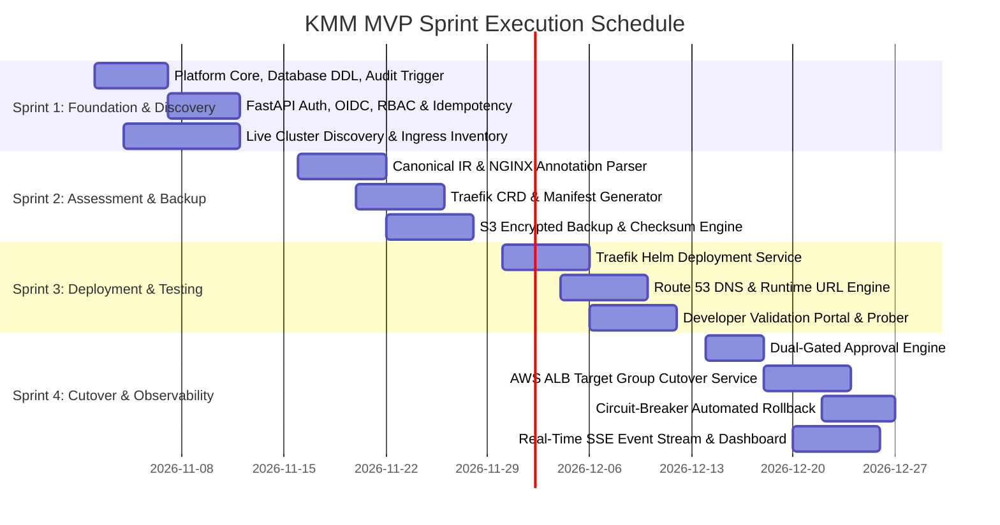

# Technical Design Document (TDD) — Part 4: Development Backlog

# Kubernetes Migration Manager (KMM) — Epics, User Stories & Sprint Plan

**Version:** 2.0  
**Status:** Implementation Blueprint  
**Methodology:** Agile / Scrum (2-week Sprints)  
**Acceptance Criteria Mapping:** PRD AC-001 through AC-030  

---

## 1. Sprint Roadmap Overview

---

## 2. Epic Breakdown & User Stories

### Epic 1: Platform Foundation, RBAC & Immutable Auditing
**Objective**: Establish production database, FastAPI framework, enterprise OIDC auth, and append-only database triggers.

#### Story 1.1: Database Schema & Migration Suite (5 SP)
- **As a** Platform Engineer,  
- **I want** the PostgreSQL 16 schema deployed with all 34 core entities, foreign key constraints, and UUID primary keys,  
- **So that** persistent storage is ready for discovery, workflows, approvals, and audits.
- **Acceptance Criteria**:
  - Alembic migration executes cleanly creating all tables in `02_database_design.md`.
  - Database trigger `prevent_audit_tampering` successfully blocks `UPDATE` and `DELETE` on `audit_events` with an exception.
  - GIN indexes created on JSONB columns for sub-second query performance. (AC-019, AC-024)

#### Story 1.2: Enterprise OIDC & RBAC Enforcement (5 SP)
- **As a** Security Officer,  
- **I want** JWT Bearer token authentication verified via OIDC with role-based route guards,  
- **So that** Developers cannot modify infrastructure and DevOps Leads have exclusive cutover approval authority.
- **Acceptance Criteria**:
  - FastAPI `SecurityScopes` enforces `admin`, `devops`, `developer`, `approver`, `auditor`.
  - Developers accessing deployment or cutover endpoints receive HTTP 403 Forbidden. (AC-011, FR-006)

---

### Epic 2: Live Cluster Discovery & Ingress Inventory
**Objective**: Connect to real Kubernetes clusters, discover NGINX deployments, Ingress resources, TLS secrets, and Helm releases.

#### Story 2.1: Cluster Registration & Dynamic API Client (5 SP)
- **As a** DevOps Engineer,  
- **I want** to register an AWS EKS cluster and validate connectivity and permissions,  
- **So that** KMM interacts safely with the target cluster.
- **Acceptance Criteria**:
  - Validates API endpoint and verifies RBAC permissions via SelfSubjectRulesReview.
  - Shows real Kubernetes version and namespace inventory. (AC-001, AC-003)

#### Story 2.2: Live NGINX Ingress Scanner (8 SP)
- **As a** DevOps Engineer,  
- **I want** KMM to scan selected namespaces and catalog Ingress resources, IngressClasses, annotations, and Services,  
- **So that** I have an accurate, real-time inventory of production routing configurations.
- **Acceptance Criteria**:
  - Extracts all Ingress v1 definitions, hosts, paths, and annotations.
  - Stores immutable `discovery_snapshots` in PostgreSQL with SHA-256 checksums. (AC-002, AC-027)

---

### Epic 3: Canonical IR & Compatibility Assessment Engine
**Objective**: Parse NGINX annotations into vendor-neutral IR and evaluate compatibility against Traefik and Gateway API.

#### Story 3.1: NGINX Annotation AST & Parser (8 SP)
- **As a** DevOps Engineer,  
- **I want** NGINX annotations mapped to Canonical `GatewayRouteIR`,  
- **So that** SSL redirects, path rewrites, rate limits, and headers are standardized.
- **Acceptance Criteria**:
  - Accurately parses standard annotations (`ssl-redirect`, `rewrite-target`, `limit-rps`, `proxy-body-size`, `whitelist-source-range`).
  - Flags custom Lua/server-snippets as blocking items requiring manual intervention. (AC-004, AC-005)

#### Story 3.2: Traefik Manifest Generator & Dry-Run Validator (8 SP)
- **As a** DevOps Engineer,  
- **I want** Traefik `IngressRoute` and `Middleware` CRDs generated and server-side validated,  
- **So that** configurations are verified before applying.
- **Acceptance Criteria**:
  - Outputs compliant Traefik manifests.
  - Runs Kubernetes server-side dry-run (`dryRun=All`).
  - Side-by-side YAML diff available via `/api/v1/migrations/{id}/diff`. (AC-004, AC-009)

---

### Epic 4: Encrypted Backup & Integrity Verification Engine
**Objective**: Create encrypted, checksummed recovery packages in AWS S3 before production-impacting operations.

#### Story 4.1: S3 Manifest Snapshotter & KMS Envelope Encryption (8 SP)
- **As a** DevOps Engineer,  
- **I want** all source Ingress YAML, Secrets, ConfigMaps, and Helm values encrypted in S3,  
- **So that** a complete, immutable recovery package is stored prior to deployment.
- **Acceptance Criteria**:
  - Packages resources into AES-256-GCM / AWS KMS encrypted archive.
  - Computes and verifies SHA-256 checksums.
  - Migration state transitions to `READY_TO_DEPLOY` only upon 100% verification. (AC-007, AC-025)

---

### Epic 5: Traefik Controller Deployment Management
**Objective**: Deploy Traefik in an isolated namespace using Helm without disrupting active NGINX traffic.

#### Story 5.1: Parallel Traefik Helm Deployment (8 SP)
- **As a** DevOps Engineer,  
- **I want** Traefik deployed in namespace `kmm-traefik-system` with an isolated IngressClass,  
- **So that** Traefik runs alongside NGINX without taking production traffic.
- **Acceptance Criteria**:
  - Uses Helm 3 SDK to deploy pinned Traefik release.
  - Verifies Traefik pod readiness, endpoints, and CRD status.
  - Leaves NGINX Ingress completely untouched and running. (AC-008, AC-018)

---

### Epic 6: Runtime URL Generation & Developer Validation Portal
**Objective**: Provision temporary runtime URLs and enable developers to perform application smoke testing.

#### Story 6.1: Route 53 DNS & Runtime URL Engine (5 SP)
- **As a** DevOps Engineer,  
- **I want** temporary runtime DNS records (e.g. `runtime-app.company.com`) created pointing to Traefik,  
- **So that** developers can test through Traefik using real hostnames and valid TLS.
- **Acceptance Criteria**:
  - Automatically registers Route 53 CNAME record.
  - Confirms TLS handshake and DNS propagation. (AC-010, FR-098)

#### Story 6.2: Developer Smoke Testing & Sign-Off Portal (5 SP)
- **As a** Developer,  
- **I want** to execute test cases against my assigned runtime URL and record approval or rejection,  
- **So that** I verify frontend/backend behavior before any production traffic changes.
- **Acceptance Criteria**:
  - Developer portal displays assigned runtime URLs with one-click synthetic health probes.
  - Developer rejection halts workflow and marks state `DEVELOPER_REJECTED`.
  - Approval is cryptographically bound to the tested configuration version. (AC-011, AC-012, AC-013)

---

### Epic 7: Dual-Gated Cutover & Circuit-Breaker Rollback
**Objective**: Enforce DevOps Lead approval, switch AWS ALB Target Groups with connection draining, and execute automated rollback if health degrades.

#### Story 7.1: Production Cutover Approval Gate (5 SP)
- **As a** DevOps Lead,  
- **I want** to review backup verification, developer approval, and cutover plans before authorizing production execution,  
- **So that** separation of duties is strictly enforced.
- **Acceptance Criteria**:
  - Cutover execution endpoint `/api/v1/migrations/{id}/cutover` returns HTTP 403 unless approved by DevOps Lead.
  - Any subsequent configuration change invalidates prior approvals. (AC-014, AC-026)

#### Story 7.2: AWS ALB Target Group Zero-Downtime Switcher (8 SP)
- **As a** DevOps Engineer,  
- **I want** the AWS ALB listener rule switched from NGINX Target Group to Traefik Target Group,  
- **So that** production traffic transitions instantly with 300s connection draining.
- **Acceptance Criteria**:
  - Modifies AWS ALB listener forward rule atomically via AWS API.
  - Keeps production DNS hostname unchanged.
  - Initiates post-cutover stabilization monitoring window. (AC-015, AC-016)

#### Story 7.3: Circuit-Breaker Automated Rollback (8 SP)
- **As a** DevOps Engineer,  
- **I want** automated rollback triggered if HTTP 5xx error rates exceed 2% or latency spikes,  
- **So that** production application availability is restored within 60 seconds without manual intervention.
- **Acceptance Criteria**:
  - Background monitor queries Prometheus / ALB metrics every 10s.
  - If threshold breached, automatically reverts ALB Target Group to NGINX.
  - Verifies NGINX traffic flow and logs evidence in `rollback_executions`. (AC-017, AC-028)

---

### Epic 8: Real-Time Event Stream & Executive Dashboard
**Objective**: Deliver a unified dashboard with Server-Sent Events (SSE) streaming live activity, logs, and metrics.

#### Story 8.1: Real-Time Activity Timeline & SSE Hub (5 SP)
- **As a** DevOps Engineer or Auditor,  
- **I want** a live activity timeline streaming state changes, pod statuses, and audit events,  
- **So that** I have full real-time operational transparency.
- **Acceptance Criteria**:
  - SSE endpoint `/api/v1/migrations/{id}/events` pushes updates within 500ms of state changes.
  - Reconnects automatically if network drops without losing state history. (AC-020, AC-021)

---

*This concludes Part 4: Development Backlog. With all 4 technical design artifacts complete, we proceed to codebase implementation.*
