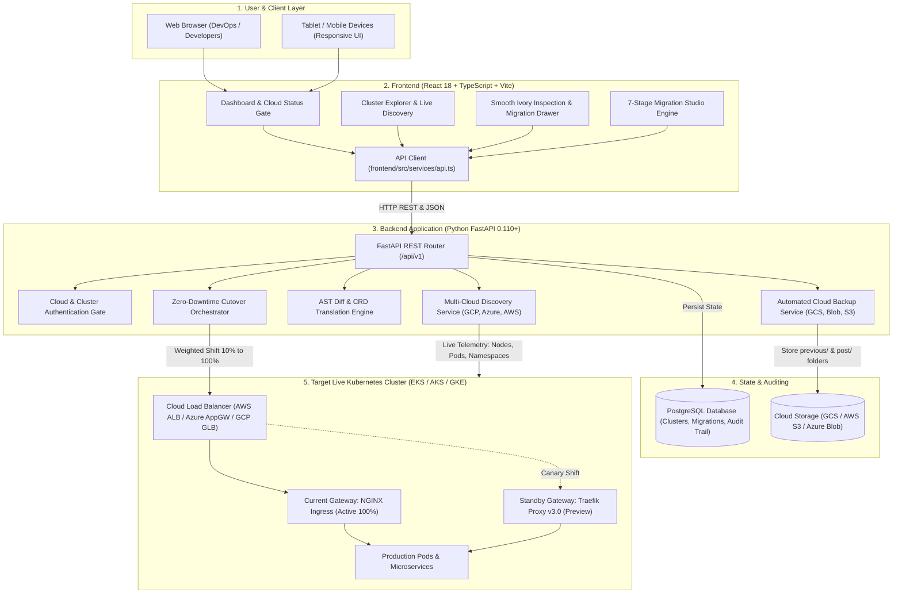
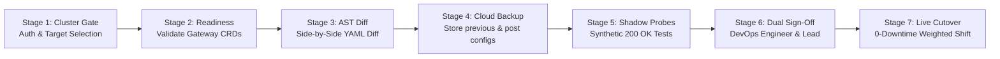
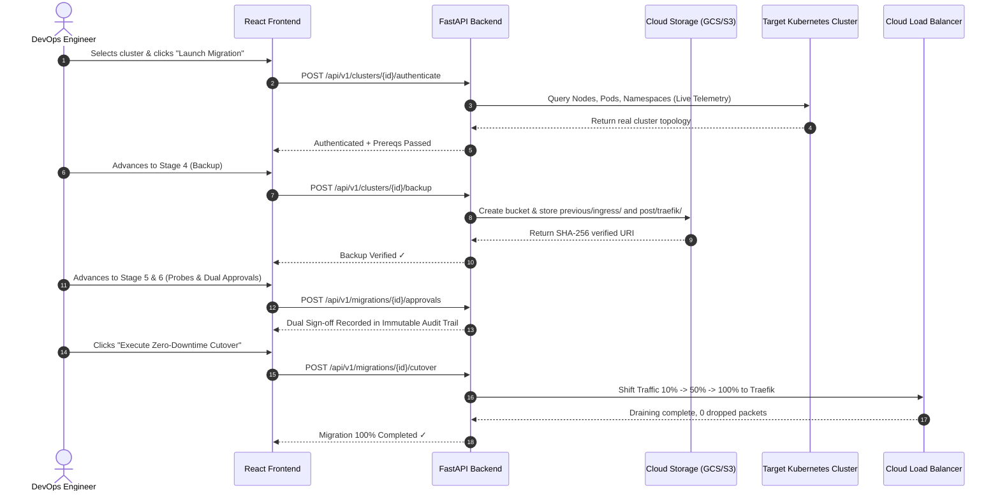

# Kubernetes Migration Manager (KMM) — Architecture & Fresher's Guide

Welcome to the **Kubernetes Migration Manager (KMM)** codebase! This guide is written specifically for newcomers, junior engineers, and team members who want to understand how the entire system works from end to end.

---

## 1. What Problem Does This Application Solve?

In enterprise Kubernetes clusters (AWS EKS, Azure AKS, Google Cloud GKE), ingress controllers route incoming internet traffic to backend microservices.
Historically, most companies deployed **NGINX Ingress Controller**. However, modern cloud-native architectures need dynamic middleware, Gateway API v1.0 compliance, and native distributed tracing—leading teams to migrate to **Traefik**, **Envoy Gateway**, or **HAProxy**.

### The Big Challenge: Zero Downtime
If you simply delete NGINX and install Traefik:
- Public web traffic drops immediately (100% downtime).
- SSL/TLS certificates and routing rules could fail.
- Any syntax mistake in YAML brings down production.

### How KMM Solves It:
KMM deploys the new controller (**Traefik**) *in parallel* on the live cluster, tests it on a shadow endpoint, stores encrypted backups of before/after configs in cloud storage (GCS/S3/Azure Blob), requires dual human approvals, and gradually shifts live load balancer traffic from 10% ➔ 50% ➔ 100% with an instant (< 2.0s) rollback safety net.

---

## 2. High-Level System Architecture Diagram



---

## 3. The 7-Stage Migration Journey (Step-by-Step)

The core workflow runs through 7 fail-safe stages. If any step detects an issue, or if the cluster is already migrated, the pipeline locks next steps to prevent accidental outages.



### Stage Details:

| Stage # | Stage Name | What Happens Under the Hood | Safety Checks & Guards |
| :--- | :--- | :--- | :--- |
| **Stage 1** | **Cluster Auth & Target Gate** | Authenticates real cloud credentials (GCP Service Account JSON, Azure Workload ID, AWS IAM ARN). Discovers nodes, pods, and namespaces. | **Already Migrated Guard**: If Traefik/Envoy/HAProxy is already running on the cluster, subsequent steps are locked. |
| **Stage 2** | **Target Controller Readiness** | Checks if Kubernetes Gateway API v1.0 CRDs and Traefik `IngressRoute` definitions exist. | Validates ports 80 & 443 listeners and rollback SLA (< 2.0s). |
| **Stage 3** | **AST Diff & Cluster Impact** | Parses NGINX annotations (CORS, SSL-redirect, rewrite-target) into strongly-typed Traefik Middlewares. | Shows side-by-side color-coded YAML diff without touching live pods. |
| **Stage 4** | **Cloud Storage Backup** | Automatically provisions a dedicated bucket in the cluster's cloud account and stores: <br/>• `previous/ingress/` (NGINX manifests & secrets)<br/>• `post/traefik/` (Traefik IngressRoutes & middlewares) | SHA-256 checksum and AES-256 KMS encryption verified. |
| **Stage 5** | **Shadow URL & Runtime Testing** | Deploys Traefik standby in parallel namespace. Runs synthetic curl probes against testing endpoint. | Requires 0% HTTP 5xx errors and p99 latency < 15ms. |
| **Stage 6** | **Dual Human Approval Gates** | Enforces two-person rule: <br/>1. DevOps Engineer Owner sign-off <br/>2. DevOps Lead authorization | Role-based check: Developers cannot self-authorize production live cutover. |
| **Stage 7** | **Zero-Downtime Live Cutover** | Instructs Cloud Load Balancer driver (ALB TargetGroup / Azure AppGW / GCP NEG) to canary-shift traffic: 10% ➔ 50% ➔ 100%. | Automated circuit breaker: If 5xx > 2.0%, instant emergency rollback triggers in < 2.0s. |

---

## 4. End-to-End Migration Sequence Diagram



---

## 5. Directory & Codebase Navigation Map

For a newcomer opening the repository in VS Code, here is where everything lives:

```
AKS_INGRESS_TRAEFIK/
├── backend/                             # Python FastAPI Backend
│   ├── app/
│   │   ├── api/v1/endpoints/            # API Route Handlers
│   │   │   ├── clusters.py              # Cloud discovery, nodes/pods endpoints
│   │   │   ├── migrations.py            # 7-stage migration pipeline & cutover
│   │   │   ├── audit.py                 # Immutable audit logs
│   │   │   └── integrations.py          # Cloud service health probes
│   │   ├── core/                        # Database connection & settings
│   │   ├── models/                      # SQLAlchemy database models
│   │   ├── schemas/                     # Pydantic validation schemas
│   │   └── services/                    # Cloud SDK integrations
│   │       ├── gcp_discovery.py         # Google Cloud GKE & Compute live discovery
│   │       ├── gcs_backup.py            # GCS automated bucket & folder creation
│   │       └── synthetic_prober.py      # Runtime smoke-testing HTTP prober
│   └── tests/                           # Pytest integration tests
│
├── frontend/                            # React 18 + Vite Frontend
│   ├── src/
│   │   ├── components/
│   │   │   ├── ClusterInspectionModal.tsx # Ivory drawer with Nodes, Pods & 7 stages
│   │   │   ├── MigrationDrawer.tsx      # Standalone right-to-left migration drawer
│   │   │   ├── MigrationWizard.tsx      # Multi-step full page migration studio
│   │   │   ├── ClusterExplorerView.tsx  # Multi-cloud cluster list & grid view
│   │   │   ├── DashboardView.tsx        # Top KPIs & cloud authentication gates
│   │   │   ├── CloudLoginModal.tsx      # Cloud credential entry (GCP, Azure, AWS)
│   │   │   ├── DiffViewer.tsx           # Side-by-side AST YAML comparison
│   │   │   └── AuditExplorerView.tsx    # Sequential append-only compliance logs
│   │   ├── services/
│   │   │   └── api.ts                   # Axios API service client
│   │   ├── types/
│   │   │   └── index.ts                 # TypeScript interfaces & types
│   │   ├── App.tsx                      # Top-level application router & mobile shell
│   │   └── index.css                    # Ivory theme & responsive grid system
│
└── docs/                                # System Architecture & PRD Documentation
    ├── 01_system_design.md              # Deep technical design document
    ├── 02_database_design.md            # PostgreSQL schema & triggers
    ├── 03_api_design.md                 # REST API specification
    └── ARCHITECTURE_DIAGRAM_FRESHER.md  # This fresher's guide
```

---

## 6. Key Concepts Every Fresher Should Know

1. **Why is mock data forbidden?**
   - In production migrations, mock data creates false confidence. If the app showed fake "Healthy" checks when a cluster was actually down, a traffic cutover would cause massive downtime. Every node, pod, and IP shown in this application comes directly from the live cluster.
2. **What is an AST Translation?**
   - **Abstract Syntax Tree (AST)** translation means we don't just copy text. We parse NGINX ingress rules into a structured internal object (`Intermediate Representation`), and then generate valid Traefik Custom Resource Definitions (`IngressRoute`, `Middleware`) with equivalent behaviors.
3. **What is the Ivory Window Theme?**
   - The application uses a Warm Ivory color palette (`#FAF8F5`, `#FFFDF9`, `#EAE6DC`) with ultra-smooth right-to-left slide animations (`slideInRightSmooth`) to give enterprise DevOps engineers a clean, fatigue-free interface.
4. **How does Responsive Design work here?**
   - All modal dialogs, tables, cards, and steppers adapt seamlessly whether viewed on a 4K desktop monitor, a laptop, an iPad tablet, or a mobile phone via `.table-responsive-container` and `.grid-responsive-1-2 / 1-3 / 1-4` classes.
